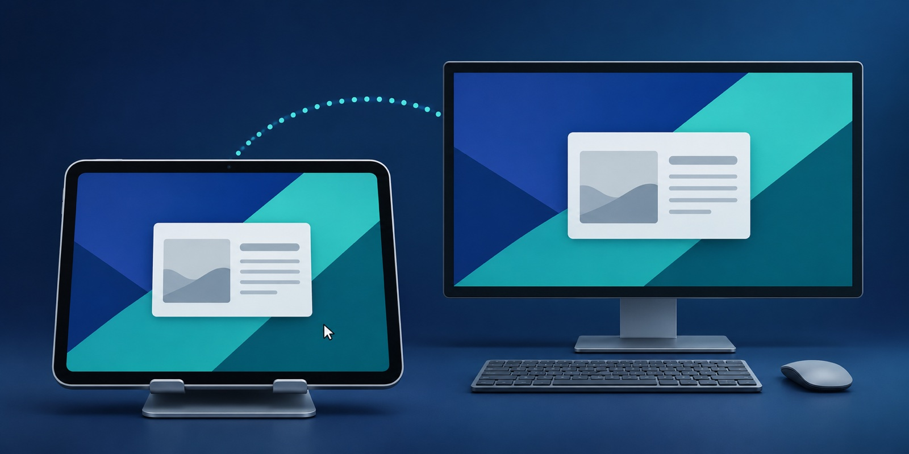
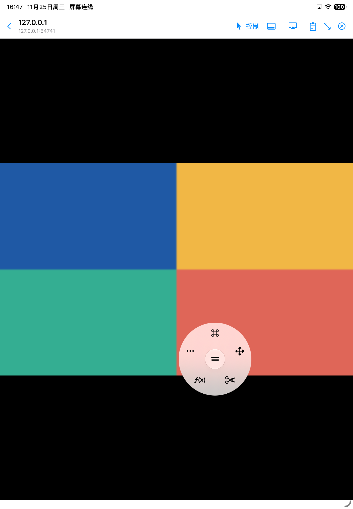

# DeskLink

**English** · [简体中文](docs/readme/README.zh-CN.md) · [Español](docs/readme/README.es.md) · [日本語](docs/readme/README.ja.md) · [한국어](docs/readme/README.ko.md)

**Control a remote computer from your iPad or Mac.** DeskLink is an open-source VNC client for accessing a Mac with Screen Sharing enabled or a computer running a compatible VNC server. Open apps, work with files, and use the remote desktop as if you were sitting in front of it.



## What you can do

- **Connect and reconnect.** Find nearby computers with Bonjour, enter a hostname or IP address, and save frequently used connections in folders.
- **Reach computers on another network.** Tunnel a VNC connection over SSH or find devices on your Tailscale network.
- **View or control a desktop.** Switch between viewing and control, use touch or a keyboard and mouse, and access shortcuts from the floating toolbar.
- **Work across displays.** Switch between remote monitors and open them in separate windows on Mac. Clipboard sharing and file transfer are available with compatible servers.

## Make your first connection

1. On the remote Mac, turn on **Screen Sharing** in **System Settings → General → Sharing**. On Linux or another host, start a compatible VNC server. [Apple’s Screen Sharing guide](https://support.apple.com/guide/mac-help/mh11848/mac).
2. On the same network, open DeskLink and pick a computer from the nearby list, or use **Quick Connect** to enter its hostname or IP address.
3. Sign in with your remote credentials. Save the connection if you want to use it again.



*An iPad session with the floating shortcut menu open.*

## Build from source

The app targets **iPadOS 18+** and **macOS 15+** through Mac Catalyst. To build it, use Xcode 26 or later.

```sh
git clone https://github.com/nikeyda/DeskLink.git
cd DeskLink
open DeskLink.xcodeproj
```

Select the **DeskLink** scheme and run it on **My Mac (Mac Catalyst)** or an **iPad simulator**. To run it on a physical iPad, configure signing in Xcode for your development team.

## License

DeskLink is available under the [MIT License](LICENSE). See the [third-party notices](App/Acknowledgements.txt) for dependency licenses.
