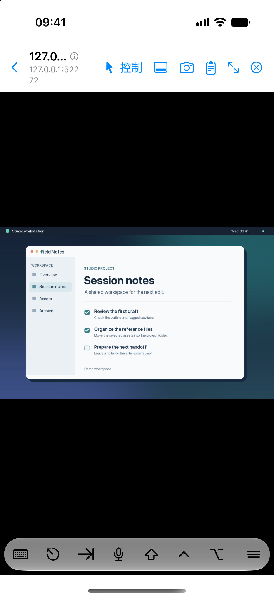
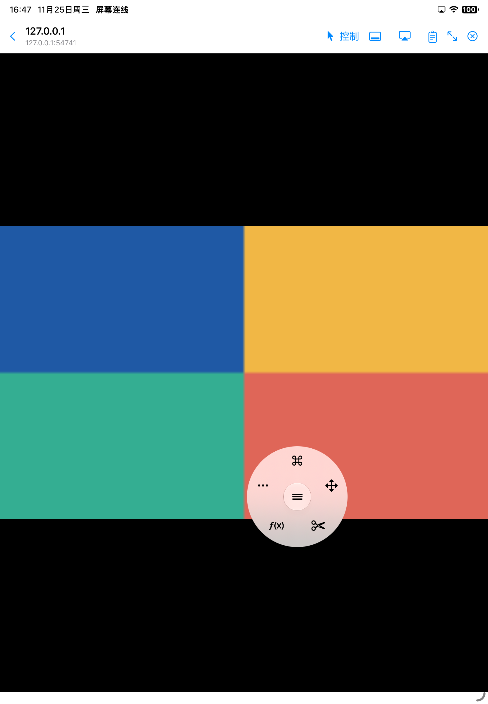
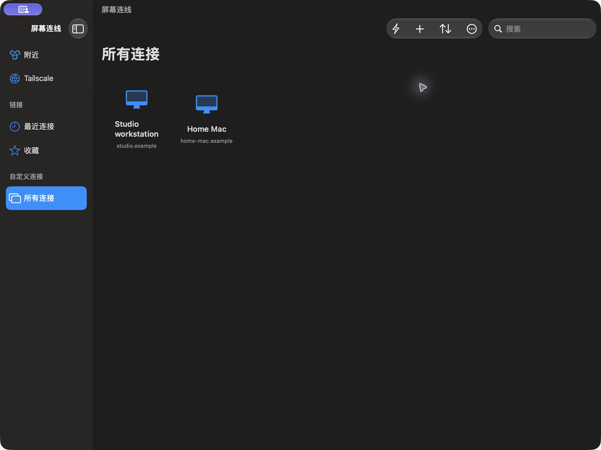

# Telescope

[English](../../README.md) · [简体中文](README.zh-CN.md) · **Español** · [日本語](README.ja.md) · [한국어](README.ko.md)

**Usa tu iPhone, iPad o Mac para ver y controlar otro ordenador.** Telescope es un cliente VNC de código abierto que se conecta a un Mac con Compartir pantalla activado o a un equipo con un servidor VNC compatible. Retoma el trabajo en tu escritorio, comprueba una estación Linux o abre un archivo en otro ordenador.

| Control remoto en el iPhone | Atajos táctiles en el iPad | Biblioteca de conexiones en el Mac |
| :---: | :---: | :---: |
| <a href="images/iphone-session.png"></a> | <a href="images/ipad-session.png"></a> | <a href="images/mac-connections.jpg"></a> |

*Capturas de Telescope con conexiones de ejemplo y un escritorio remoto de demostración. Selecciona una imagen para verla a tamaño completo.*

## Qué puedes hacer

- **Encuentra equipos y guarda conexiones.** Descubre ordenadores cercanos mediante Bonjour o escribe un nombre de host o una dirección IP. Organiza las conexiones que usas con frecuencia en carpetas.
- **Accede a equipos de otras redes.** Conecta mediante un túnel SSH o busca dispositivos en tu red de Tailscale.
- **Visualiza o controla el escritorio.** Alterna entre los modos de observación y control, usa la pantalla táctil o el teclado y el ratón, y accede a los atajos desde la barra flotante.
- **Trabaja con varios monitores.** Cambia entre pantallas remotas y ábrelas en ventanas separadas en el Mac. El portapapeles compartido y la transferencia de archivos requieren un servidor compatible.

## Primera conexión

1. En el Mac remoto, activa **Compartir pantalla** en **Ajustes del Sistema → General → Compartir**. En Linux u otro equipo, inicia un servidor VNC compatible. [Guía de Apple para compartir pantalla](https://support.apple.com/es-es/guide/mac-help/-mh11848/mac).
2. En la misma red, abre Telescope y elige un ordenador cercano, o usa la conexión rápida para introducir su nombre de host o dirección IP.
3. Inicia sesión con las credenciales del equipo remoto. Guarda la conexión si quieres volver a usarla.

## Compilar desde el código fuente

La aplicación es compatible con **iOS 18 o posterior**, **iPadOS 18 o posterior** y **macOS 15 o posterior** mediante Mac Catalyst. Para compilarla, usa Xcode 26 o posterior.

```sh
git clone https://github.com/nikeyda/DeskLink.git
cd DeskLink
open DeskLink.xcodeproj
```

Selecciona el esquema **DeskLink** y ejecuta la aplicación en **My Mac (Mac Catalyst)** o en un **simulador de iPhone o iPad**. En un iPhone o iPad físico, configura la firma en Xcode con tu equipo de desarrollo.

## Licencia

Telescope está disponible bajo la [licencia MIT](../../LICENSE). Consulta los [avisos de terceros](../../App/Acknowledgements.txt) para conocer las licencias de las dependencias.
