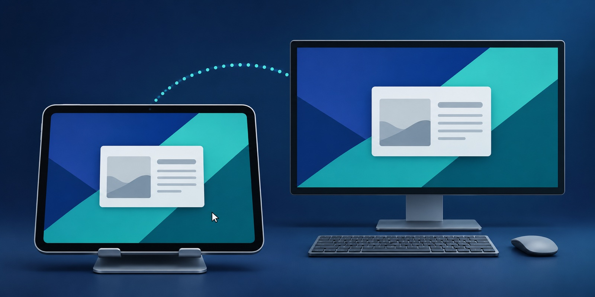
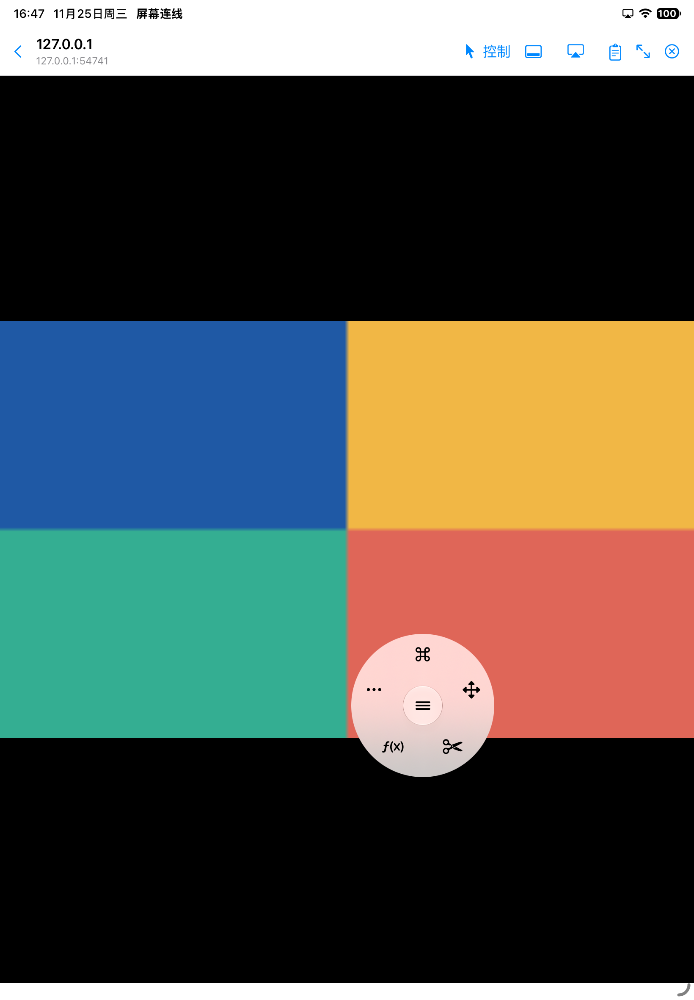

# DeskLink

[English](../../README.md) · [简体中文](README.zh-CN.md) · [Español](README.es.md) · **日本語** · [한국어](README.ko.md)

**iPad や Mac から離れた場所にあるコンピュータを操作できます。** DeskLink はオープンソースの VNC クライアントです。「画面共有」を有効にした Mac や、互換性のある VNC サーバーを実行しているコンピュータに接続し、手元にあるかのようにアプリを開いたり、ファイルを操作したりできます。



## 主な機能

- **接続先の検索と保存。** Bonjour で近くのコンピュータを見つけるか、ホスト名や IP アドレスを直接入力します。よく使う接続先はフォルダに整理できます。
- **別のネットワークへの接続。** SSH トンネル経由で VNC に接続したり、Tailscale ネットワーク内のデバイスを探したりできます。
- **リモート画面の表示と操作。** 観察モードと操作モードを切り替え、タッチやキーボードとマウスで操作できます。フローティングツールバーからショートカットを使えます。
- **複数のディスプレイ。** リモート側の画面を切り替えたり、Mac で各画面を別々のウインドウに表示したりできます。クリップボード共有とファイル転送には対応するサーバーが必要です。

## はじめて接続する

1. 接続先が Mac の場合は「システム設定 → 一般 → 共有」で「画面共有」をオンにします。Linux などでは、互換性のある VNC サーバーを起動します。[Apple の画面共有ガイド](https://support.apple.com/ja-jp/guide/mac-help/mh11848/mac/1000)
2. 同じネットワーク上で DeskLink を開き、近くのコンピュータを選ぶか、クイック接続でホスト名または IP アドレスを入力します。
3. 接続先の認証情報でログインします。繰り返し使う場合は接続先を保存できます。



*フローティングショートカットメニューを開いた iPad のリモートデスクトップ接続。*

## ソースからビルドする

対応環境は **iPadOS 18 以降**と **macOS 15 以降**（Mac Catalyst）です。ビルドには Xcode 26 以降を使用してください。

```sh
git clone https://github.com/nikeyda/DeskLink.git
cd DeskLink
open DeskLink.xcodeproj
```

**DeskLink** スキームを選び、**My Mac (Mac Catalyst)** または **iPad シミュレータ**で実行します。iPad の実機で実行するには、Xcode でご自身の開発チームの署名を設定してください。

## ライセンス

DeskLink は [MIT ライセンス](../../LICENSE)で公開されています。依存ライブラリのライセンスは[サードパーティのライセンス情報](../../App/Acknowledgements.txt)を参照してください。
