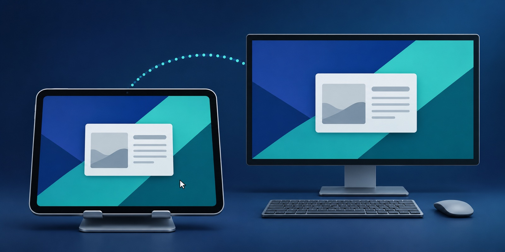
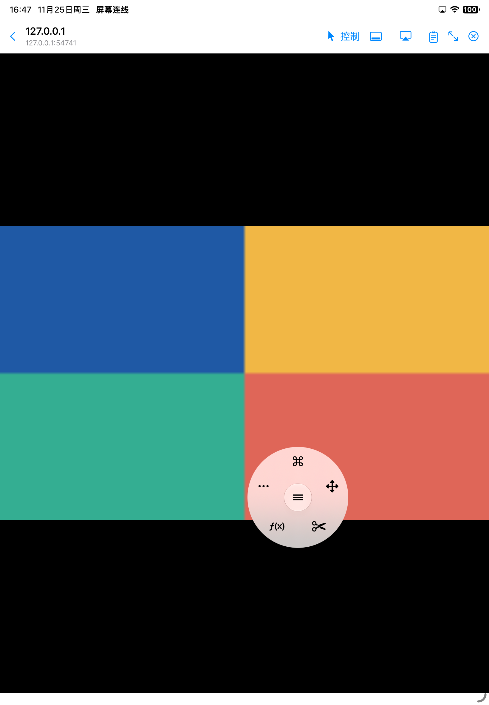

# DeskLink

[English](../../README.md) · [简体中文](README.zh-CN.md) · [Español](README.es.md) · [日本語](README.ja.md) · **한국어**

**iPad나 Mac으로 원격 컴퓨터를 제어하세요.** DeskLink는 화면 공유가 켜진 Mac이나 호환되는 VNC 서버를 실행 중인 컴퓨터에 연결할 수 있는 오픈 소스 VNC 클라이언트입니다. 컴퓨터 앞에 앉아 있는 것처럼 원격 데스크톱에서 앱을 열고 파일을 다룰 수 있습니다.



## 주요 기능

- **컴퓨터를 찾고 연결을 저장하세요.** Bonjour로 주변 컴퓨터를 검색하거나 호스트 이름 또는 IP 주소를 직접 입력하세요. 자주 쓰는 연결은 폴더에 정리할 수 있습니다.
- **다른 네트워크의 컴퓨터에 연결하세요.** SSH 터널로 VNC에 연결하거나 Tailscale 네트워크에서 기기를 찾을 수 있습니다.
- **원격 화면을 보거나 제어하세요.** 관찰 모드와 제어 모드를 전환하고, 터치 또는 키보드와 마우스로 조작하세요. 플로팅 도구 막대에서 단축키를 사용할 수 있습니다.
- **여러 디스플레이를 사용하세요.** 원격 모니터를 전환하고 Mac에서 각각의 화면을 별도 윈도우로 열 수 있습니다. 클립보드 공유와 파일 전송은 서버에서 지원해야 합니다.

## 처음 연결하기

1. 원격 Mac의 **시스템 설정 → 일반 → 공유**에서 **화면 공유**를 켜세요. Linux 등의 다른 컴퓨터에서는 호환되는 VNC 서버를 실행하세요. [Apple 화면 공유 안내서](https://support.apple.com/ko-kr/guide/mac-help/mh11848/mac/1000)
2. 같은 네트워크에서 DeskLink를 열어 주변 컴퓨터를 선택하거나, 빠른 연결에 호스트 이름 또는 IP 주소를 입력하세요.
3. 원격 컴퓨터의 인증 정보로 로그인하세요. 다시 연결할 때 사용할 수 있도록 연결을 저장할 수 있습니다.



*플로팅 단축키 메뉴를 연 iPad 원격 데스크톱 세션.*

## 소스에서 빌드하기

앱은 **iPadOS 18 이상** 및 **macOS 15 이상**(Mac Catalyst)을 지원합니다. 빌드에는 Xcode 26 이상을 사용하세요.

```sh
git clone https://github.com/nikeyda/DeskLink.git
cd DeskLink
open DeskLink.xcodeproj
```

**DeskLink** 스킴을 선택하고 **My Mac (Mac Catalyst)** 또는 **iPad 시뮬레이터**에서 실행하세요. 실제 iPad에서 실행하려면 Xcode에서 개발 팀의 서명을 설정하세요.

## 라이선스

DeskLink는 [MIT 라이선스](../../LICENSE)로 제공됩니다. 의존성 라이선스는 [타사 라이선스 고지](../../App/Acknowledgements.txt)를 참고하세요.
