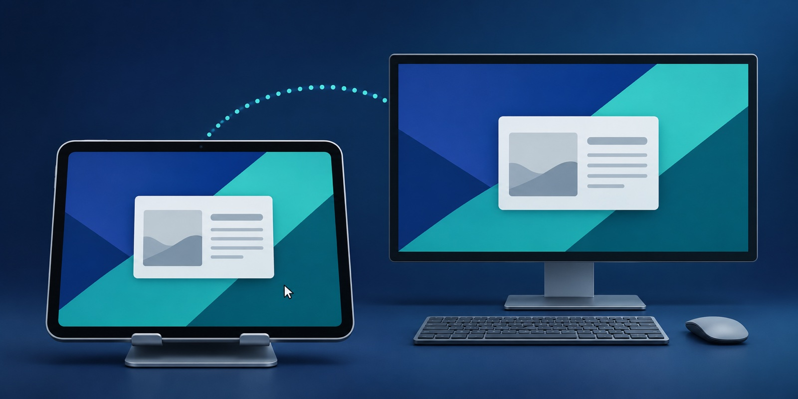
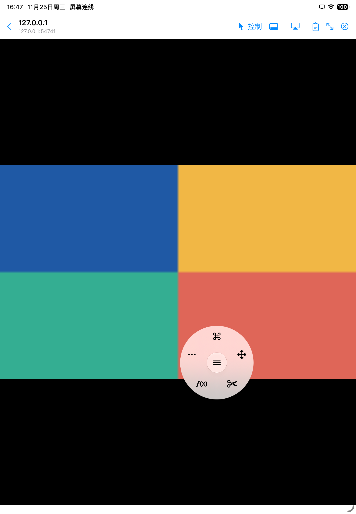

# DeskLink 屏幕连线

[English](../../README.md) · **简体中文** · [Español](README.es.md) · [日本語](README.ja.md) · [한국어](README.ko.md)

**用 iPad 或 Mac 控制另一台电脑。** DeskLink 是开源的 VNC 客户端，可以连接开启了「屏幕共享」的 Mac，或运行兼容 VNC 服务的电脑。连接后，你可以查看远端桌面、打开应用、操作文件，就像坐在那台电脑前一样。



## 可以用它做什么

- **找到并保存连接。** 通过 Bonjour 发现附近的电脑，也可以直接输入主机名或 IP 地址，将常用连接保存到文件夹。
- **连接其他网络中的电脑。** 通过 SSH 隧道建立 VNC 连接，或从你的 Tailscale 网络中查找设备。
- **查看或控制远端桌面。** 在观察与控制模式间切换，使用触控或键盘和鼠标，通过悬浮工具栏调用快捷操作。
- **使用多块屏幕。** 在远端显示器之间切换，或在 Mac 上用不同窗口分别打开。剪贴板共享和文件传输需要服务端支持。

## 建立第一次连接

1. 如果远端是 Mac，在「系统设置 → 通用 → 共享」中打开「屏幕共享」。如果远端是 Linux 或其他电脑，启动兼容的 VNC 服务。[Apple 屏幕共享指南](https://support.apple.com/zh-cn/guide/mac-help/mh11848/mac/1000)
2. 在同一网络上打开 DeskLink，从「附近」选择电脑，或在「快速连接」中输入主机名或 IP 地址。
3. 使用远端电脑的凭据登录。之后还要连接时，可以把它保存下来。



*iPad 上的远程桌面会话，图中已打开悬浮快捷菜单。*

## 从源码构建

应用支持 **iPadOS 18+** 和 **macOS 15+**（Mac Catalyst）。构建需要 Xcode 26 或更高版本。

```sh
git clone https://github.com/nikeyda/DeskLink.git
cd DeskLink
open DeskLink.xcodeproj
```

选择 **DeskLink** scheme，在 **My Mac (Mac Catalyst)** 或 **iPad 模拟器**上运行。在 iPad 真机运行时，请在 Xcode 中配置自己的开发团队签名。

## 许可证

DeskLink 采用 [MIT 许可证](../../LICENSE)。依赖项的许可证见[第三方声明](../../App/Acknowledgements.txt)。
